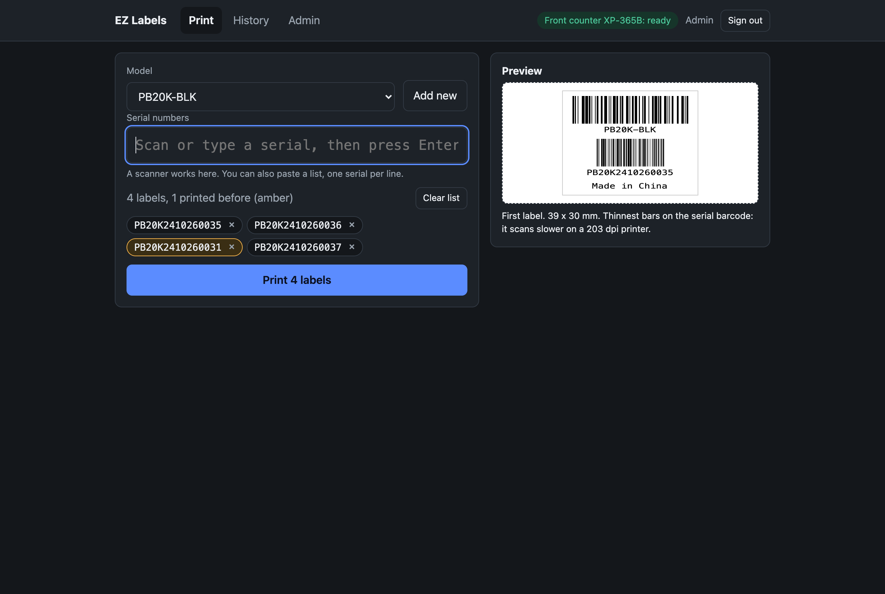
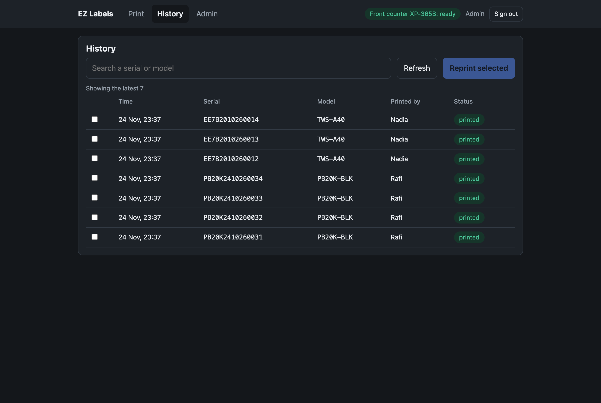
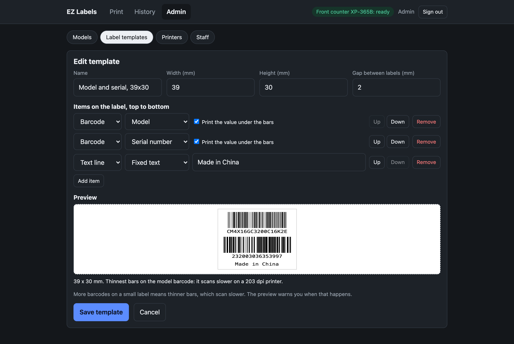
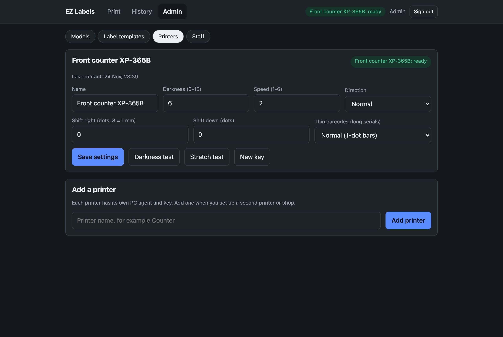
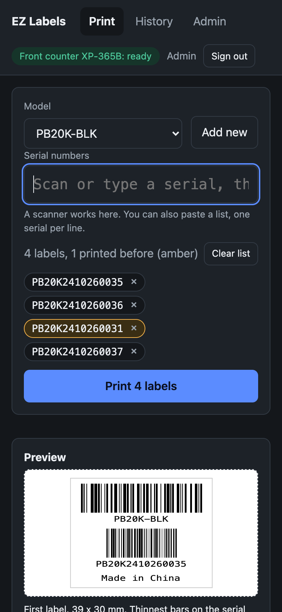

# EZ Label Printing

A small web app for printing serial-number barcode labels on a thermal label printer. Staff open a web page on any phone or PC, scan or type serials, and press Print. A small agent on the Windows PC next to the printer picks up the job and prints it.

It runs on Cloudflare's free plan.

## Screenshots

These are from a local test run with made-up demo data (no real serials or staff).

**Print**: scan or type serials. The preview is drawn by the same engine that makes the printer commands. A serial printed before is marked in amber.



**History**: who printed what and when, with reprint.



**Label template editor** with a live preview and a warning when bars get thin.



**Printer settings**: darkness, speed, offset, the "thin barcodes" stretch setting, and test prints.



**On a phone.**



## Why I built it

I work at a small gadget shop, and every device we stock gets a label with its serial number as a barcode. We print them on an Xprinter XP-365B (203 dpi, USB, TSPL).

Before this app, labels were printed with a Python script on the one PC connected to the printer. Only someone sitting at that PC could print, and no one could see what had been printed. I wanted anyone in the shop to be able to send labels from their phone, with a history of who printed what, and no monthly hosting bill.

## What it does

- **Print tab**: scan or type serials (one per line), pick a template and a printer, and print. Serials that were printed before are flagged.
- **History tab**: every printed label, with who printed it and when. Labels can be reprinted from here.
- **Admin tab**: staff accounts, printers (darkness, speed, direction, offset, barcode stretch), and label templates with a live preview.
- **Print agent**: a Python program on the Windows PC with the printer. It only makes outbound requests, so the shop network needs no open ports.

## Architecture

```
 phone / PC browser                 Cloudflare (free plan)                 shop PC
 ------------------               --------------------------            ---------------
  public/app.js      --HTTPS-->    src/worker.js  (Worker API)  <--poll--  agent/ezagent.py
  public/engine.js                 public/engine.js (same file)            |
  (live preview)                   D1 database (SQLite)                    v  raw TSPL
                                                                       XP-365B printer
```

- **Cloudflare Worker + D1** (`src/worker.js`). This is the API for logins, the print queue, history, printers and templates. Data is in D1 (Cloudflare's SQLite). The schema is created on first use, and new columns are added with guarded `ALTER TABLE`, so there is no separate migration step.
- **Shared label engine** (`public/engine.js`). It does the Code 128 encoding, the layout, the TSPL output and an SVG preview. The same file runs in the browser for the preview and in the Worker for the real print job, so the preview shows the bars and text exactly where they will print.
- **Polling print agent** (`agent/ezagent.py`). It asks the server for work every 4 seconds, sends the TSPL bytes to the printer as a RAW job through `win32print`, and reports back whether each label printed. Each printer has its own key, which is stored on the server as a hash.
- **Front end** (`public/app.js`, `index.html`, `style.css`). Plain JavaScript with no framework and no build step.
- **Logins**: passwords are hashed with PBKDF2 and a per-user salt. Sessions use an HttpOnly cookie, and only a hash of the session token is stored. Repeated wrong passwords lock the account for a while.

## Engineering problems I solved

### Thin barcodes that scanned badly

At 203 dpi one printer dot is about 0.125 mm, and every bar has to be a whole number of dots. A 14-character serial that mixes letters and digits (for example `EE7B2010260012`) is 145 Code 128 modules. Add 2 mm of quiet zone on each side, and on a 38 mm label it only fits with bars 1 dot wide.

1-dot bars are at the printer's limit. Thermal ink spreads slightly, so thin bars and gaps blur together. Our 1D laser scanner coped, but the newer camera scanner often failed. Serials made of digits only don't have this problem, because Code 128 packs two digits into each symbol and they fit at 2 dots.

`bestModule` picks the thickest whole-dot bar width that fits the label. It goes up to 3 dots and always keeps the 2 mm quiet zones.

### Fractional bar stretching

When a barcode would come out at 1 dot, the engine can stretch it to a fractional module width, about 1.5, 1.76 or 1.84 dots, by mixing 1- and 2-dot bars across the code. `stretchModule` searches for the width that fills the space while keeping the ratios between bar widths as close as possible to the Code 128 spec. A scanner reads the code by comparing bar widths with each other, so this matters more than the exact size.

This is a printer setting with three levels (mild, medium, wide). A built-in stretch test prints four labels side by side so the result can be checked with the real scanner. In my tests at the shop, the two widest levels read best on the camera scanner.

### Free-plan CPU limit

The Cloudflare free plan allows 10 ms of CPU time per request. Building a label (encoding, layout, TSPL output) is cheap, but a batch of a few hundred labels is not. So:

- The agent receives at most 10 labels per poll (`CHUNK = 10`), and a big job is spread over several polls.
- Encoded bar widths and stretch results are cached in memory. The model code is the same on every label in a batch, so most of the work is done once.

### Measuring the printer's font width

To centre text and choose between the printer's built-in fonts, the engine needs to know how wide each character prints. The manual says font 2 is 12 dots per character. On printed labels it measured about 13.4 dots, so text that should have been centred drifted to the right, and long text ran off the edge. The engine uses the measured widths (13.4 for font 2, 9 for font 1). If text doesn't fit in font 2, it falls back to font 1.

### Testing without the printer

The printer and scanners are only in the shop, so most testing was done elsewhere. I ran API scripts against `wrangler dev --local` and tested the UI in a browser. For the barcodes, I drew the TSPL output as an image at one dot per pixel and decoded it with zxing-cpp, which confirms the bars encode the right serial. Print quality and scan reliability can only be checked on the real printer.

## Deploy your own

You need Node.js and a free Cloudflare account.

```
npm install
npx wrangler login
npx wrangler d1 create ez-labels
```

Copy the `database_id` printed by the last command into `wrangler.jsonc` in place of the one there. Then:

```
npx wrangler deploy
```

Open the address it prints. The first visit asks you to create the admin account. Then go to Admin > Printers, add a printer, and copy its key (it starts with `ezk_` and is shown only once).

On the Windows PC with the printer, install Python 3 and `pywin32`, copy the `agent` folder there, and run:

```
pip install pywin32
python ezagent.py
```

It asks for the app address and the printer key the first time. `install_autostart.bat` makes it start with Windows. [SETUP.md](SETUP.md) has the full step-by-step guide.

To test locally with a throwaway database:

```
npx wrangler dev --local --port 8799
```

### Printer notes

- The label size and gap are sent in the TSPL header, so the paper size set in the Windows driver doesn't matter.
- Calibrate the printer's gap sensor after changing label rolls.
- Labels I have used: 38 x 25 mm and 39 x 30 mm. A 40 mm wide label gives long serials more room.

## Free-plan limits

| Limit | What it means here |
|---|---|
| 100,000 Worker requests a day | The agent polls every 4 s, about 21,600 requests a day per printer. Staff use is small on top of that. |
| 10 ms CPU per request | Labels go to the agent 10 at a time, and encoded barcodes are cached. |
| D1 free storage and reads | Far more than a small shop's label history needs. |

If the daily limit is ever reached, printing pauses until it resets (00:00 UTC). The agent keeps retrying and catches up by itself.

## Known gaps

- The template preview uses a sample serial made only of digits, so it can look better than a real serial with letters.
- Printer faults (paper out, cover open) are not yet shown on the web page.
- There is no admin password reset in the UI yet.
- Only the barcode engine has an automated test (`node test/engine.test.mjs`). The API and UI were tested with ad hoc scripts against `wrangler dev --local`.

## Tech

Cloudflare Workers, Cloudflare D1, vanilla JavaScript, Python 3 with pywin32, TSPL, Code 128.
